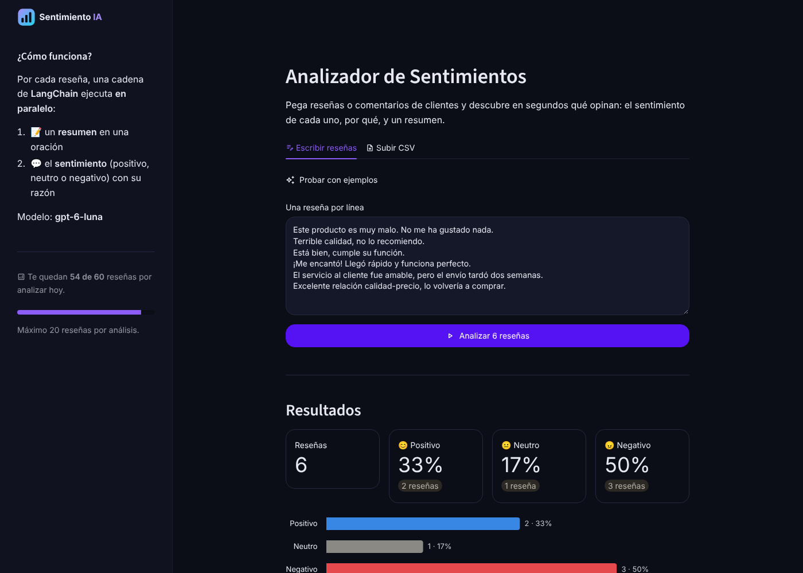

# 🧠 Analizador de Sentimientos con LangChain y OpenAI

Este proyecto implementa un pipeline completo de análisis de texto utilizando **LangChain**, **OpenAI** y procesamiento funcional.
El sistema genera un **resumen** del texto y un **análisis de sentimiento**, ejecutados en paralelo para mayor eficiencia.

Incluye una **app web con Streamlit** para pegar reseñas o subir un CSV y ver los resultados con gráficos.



---

## 🚀 Características principales

- 🔥 **Preprocesamiento automático** del texto (quita espacios extra y limita a 500 caracteres sin cortar palabras)
- 🧠 **Generación de resumen** usando LLM
- 💬 **Análisis de sentimiento** (positivo, negativo o neutro) con **salida estructurada** (`with_structured_output` + Pydantic): el modelo siempre responde con el formato correcto
- ⚡ **Ejecución paralela** con `RunnableParallel`
- 🔗 **Pipeline completo** usando operadores de LangChain (`|`)
- 📦 **Procesamiento por lotes (batch)** para múltiples textos
- ⚠️ Los errores se reportan como `error`, no se disfrazan de "neutro"
- 🌐 **App web** (`app.py`): reseñas escritas o desde un **CSV**, porcentajes por sentimiento, gráfico, detalle filtrable y descarga de resultados en CSV
- 🛡️ **Límite de reseñas por usuario y por día** en la app, más un tope global para proteger tu saldo de OpenAI

---

## 🔗 Cómo funciona la cadena

```
texto → preprocesamiento → ┬→ resumen ─────┬→ unión → {resumen, sentimiento, razon}
                           └→ sentimiento ─┘
```

---

## 🌐 App web (Streamlit)

```bash
pip install -r requirements.txt
```

Crea `.streamlit/secrets.toml` copiando `.streamlit/secrets.toml.example` y pon tu clave:

```toml
OPENAI_API_KEY = "sk-..."
```

```bash
streamlit run app.py
```

Se abre en `http://localhost:8501`. Puedes escribir una reseña por línea, o subir un CSV y elegir la columna que tiene las reseñas (detecta solo si el separador es coma o punto y coma).

### Desplegarla gratis en Streamlit Community Cloud

1. Entra a [share.streamlit.io](https://share.streamlit.io) con tu cuenta de GitHub.
2. **Create app** → este repositorio, rama `main`, archivo **`app.py`**.
3. En **Advanced settings → Secrets** pega el contenido de `.streamlit/secrets.toml.example` con tu clave real.
4. **Deploy**.

| Variable (Secrets) | Qué hace | Por defecto |
|---|---|---|
| `OPENAI_API_KEY` | Tu clave de OpenAI | — |
| `MAX_RESENAS_POR_ANALISIS` | Reseñas por análisis | `20` |
| `MAX_RESENAS_POR_USUARIO` | Reseñas por usuario al día | `60` |
| `MAX_RESENAS_GLOBALES_DIA` | Tope diario entre todos los usuarios | `1500` |
| `OPENAI_MODEL` | Modelo de OpenAI (opcional) | `gpt-6-luna` |

---

## 💻 Cómo ejecutarlo en la terminal

Necesitas Python 3.10 o superior y una API Key de OpenAI.

```bash
pip install -r requirements.txt
```

Configura tu clave en la terminal:

```bash
# Windows (PowerShell)
$env:OPENAI_API_KEY="sk-..."

# Mac / Linux
export OPENAI_API_KEY="sk-..."
```

Ejecuta:

```bash
python analizador_sentimientos.py
```

Ejemplo de salida (la redacción exacta de la razón y el resumen cambia en cada ejecución):

```
Analizando 4 reseñas con gpt-6-luna...

[1] Este producto es muy malo. No me ha gustado nada.
    Sentimiento: 😠 NEGATIVO
    Razón:       El usuario expresa una opinión claramente desfavorable del producto.
    Resumen:     El usuario está muy insatisfecho con el producto.
```

Para analizar tus propios textos, edita la lista `review_batch` en `analizador_sentimientos.py`.

**Modelo:** por defecto usa `gpt-6-luna`, el modelo más económico de OpenAI (reemplaza a `gpt-4o-mini`, que OpenAI retira de su API el 14 de enero de 2027). Puedes usar otro con la variable de entorno `OPENAI_MODEL`.

---

## 📁 Estructura del proyecto

```
analizador_sentimientos.py   # Cadena de LangChain, ejemplos y ejecución en la terminal
app.py                       # App web con Streamlit (usa la misma cadena)
limite_uso.py                # Límite de reseñas por usuario y tope global diario
requirements.txt             # Librerías con versiones fijas
assets/                      # Logo e ícono de la app
docs/captura.png             # Captura usada en este README
.streamlit/config.toml       # Tema de la app (colores, tipografía)
.streamlit/secrets.toml.example  # Plantilla de configuración
README.md
```

---

## 🏗️ Tecnologías

- Python 3.10+
- LangChain (LCEL, `RunnableLambda`, `RunnableParallel`, `ChatPromptTemplate`)
- OpenAI API (GPT-6 Luna)
- Pydantic (salida estructurada)
- Streamlit, pandas y Altair (app web y gráficos)
